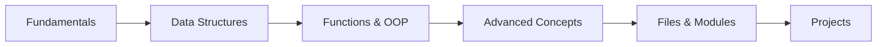

<div align="center">

# Python Foundations

**A structured, hands-on journey from Python fundamentals to practical command-line applications.**


**147 Scripts** · **20 Topic Modules** · **8 Projects**

</div>

---

## About

This repository records how I learned Python, step by step. Each concept gets its own numbered folder of short, focused scripts, and the later folders put those concepts to work in small projects: file automation, PDF processing, API clients, and an AI chatbot.

## Learning Path



## Skills Demonstrated

- **Core language:** control flow, `match`/`case`, string handling, comprehensions, recursion
- **Object-oriented design:** classes, inheritance, operator overloading, properties, dunder methods
- **Functional and advanced features:** decorators, `map`/`filter`/`reduce`, `*args`/`**kwargs`, the walrus operator
- **Robust code:** exception handling with `try`/`except`/`else`/`finally`, input validation
- **Automation and tooling:** file I/O, `os`, `shutil`, `argparse` CLIs, threading, regular expressions
- **Working with external services:** REST APIs with `requests`, the OpenAI API, third-party libraries in virtual environments

## Topics Covered

| Category | Folders | Highlights |
| --- | --- | --- |
| **Python Fundamentals** | `01_basics_Part_1`, `02_python_syntax` – `10_strings.py` | Variables, type casting, operators, conditionals, loops, slicing, f-strings |
| **Data Structures** | `12_lists`, `13_tuples`, `14_sets`, `15_dictionaries`, `15.1_Practice` | Methods, unpacking, set operations, list and dict comprehensions |
| **Functions and OOP** | `11_functions`, `16_oops` | Lambdas, recursion, scope, docstrings, constructors, inheritance |
| **Advanced Concepts** | `17_python_advanced_concepts` | Decorators with arguments, getters/setters, static and class methods, error handling |
| **File Handling and External Modules** | `18_files`, `19_external_modules`, `20_ai` | Context managers, `shutil`, `argparse`, `venv`, `requests`, regex, threading, LLM API |

## Projects

| Project | What it does | Built with |
| --- | --- | --- |
| [PDF Merger](21_projects/pdfmerger) | Merges PDFs. The [upgraded version](21_projects/pdfmerger/upgrade) lets you choose specific pages or page ranges from each file and checks for missing files and invalid page numbers | `PyPDF2`, `pypdf` |
| [AI Chatbot](21_projects/ai-chatbot) | Terminal chatbot that keeps the full conversation history | OpenAI API |
| [News Fetcher](21_projects/news-api) | Searches recent news on any topic and lists the headlines with links | `requests`, NewsAPI |
| [QR Code Generator](21_projects/QR%20code) | Turns a URL into a PNG QR code with custom size and border | `qrcode` |
| [File Organizer](21_projects/file%20organizer) | Moves `.jpg` files into an `images/` folder and renames them in order | `os` |
| [Reminder](21_projects/reminder) | Sends an hourly desktop notification | `plyer` |
| [Calculator](21_projects/calculator) | Interactive calculator with error handling | `match`/`case` |
| [Millionaire Quiz](21_projects/millionaire) | Multiple-choice quiz game with a prize ladder | Lists, loops |

## Getting Started

**Prerequisites:** Python 3.10 or later

```bash
# Clone the repository
git clone https://github.com/sachinkumar-git/python-learning.git
cd python-learning

# Create and activate a virtual environment
python -m venv venv
venv\Scripts\activate          # Windows
source venv/bin/activate       # macOS / Linux

# Install the packages the projects use
pip install requests qrcode pillow PyPDF2 pypdf plyer openai
```

**Run an example:**

```bash
python 16_oops/04_inheritance.py
python 18_files/08_argparse.py 10 5 add
python "21_projects/pdfmerger/upgrade/main.py"
```

> `news-api` needs a NewsAPI key and `ai-chatbot` needs an OpenAI API key.

<details>
<summary><b>Repository structure</b></summary>

```
python-foundations/
├── 01_basics_Part_1/             # First pass: variables to functions
├── 02_python_syntax/
├── 03_variables/
├── 04_typecasting/
├── 05_user_input/
├── 06_comments_print_esc/
├── 07_operators/
├── 08_conditionals/
├── 09_loops/
├── 10_strings.py/
├── 11_functions/
├── 12_lists/
├── 13_tuples/
├── 14_sets/
├── 15_dictionaries/
├── 15.1_Practice/                # Data structure exercises
├── 16_oops/
├── 17_python_advanced_concepts/
├── 18_files/
├── 19_external_modules/
├── 20_ai/
└── 21_projects/                  # Applied projects
```

</details>

---

<div align="center">

Built by <b>Sachin Kumar</b> · <a href="https://github.com/sachinkumar-git">GitHub</a>

</div>
